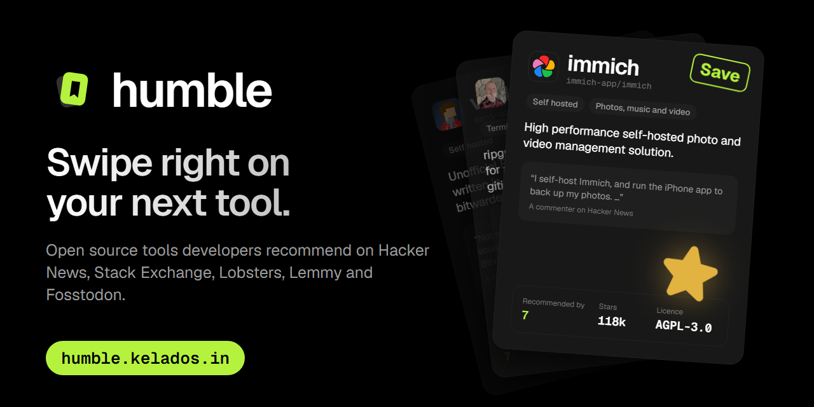
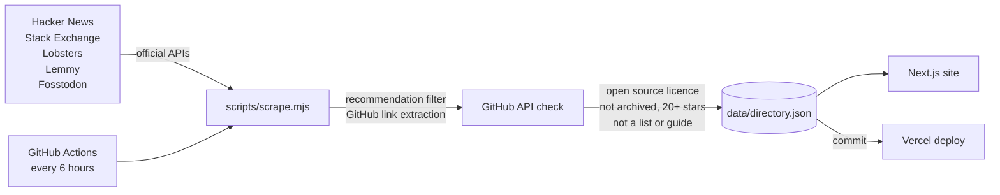

<p align="center">
  <a href="https://humble.kelados.in">
    
  </a>
</p>

<p align="center">
  <a href="https://humble.kelados.in"><strong>humble.kelados.in</strong></a>
  ·
  <a href="https://github.com/LovekeshAnand/humble/issues/new?labels=bug">Report a bug</a>
  ·
  <a href="https://github.com/LovekeshAnand/humble/issues/new?labels=enhancement">Request a feature</a>
  ·
  <a href="CONTRIBUTING.md">Contribute</a>
</p>

<p align="center">
  
  
  
  
</p>

---

The best tool recommendations are buried in comment threads. Someone on Hacker News writes *"I've been using X for three years, it's great"*, the thread scrolls away, and nobody finds X again.

**humble** collects those recommendations from developer communities, keeps the ones that point at real open source projects, and deals them to you one card at a time. Swipe right to save, left to skip. The deck learns what you like.

## Features

- **Swipe deck.** Drag, tap or use the arrow keys. A GitHub style star pops on every save, undo brings back the last card, and a short guided tour explains it all on the first visit.
- **Recommendations that learn.** Every save and skip tunes the next card toward the categories, topics and languages you like, with a little exploration so the deck never collapses into one niche.
- **Real quotes, real people.** Every card shows what someone actually said about the tool, with a link back to the original comment. "Recommended by" counts distinct people, so self promotion cannot inflate it.
- **Search by problem.** Type *"back up my photos without Google"* and get Immich and Ente. Rare words count more than common ones, so results stay on topic.
- **Saved list you can take with you.** Copy as Markdown, download a `.md` file, or share a link to the whole list.
- **Optional accounts.** Works without signing in. Sign in and your saves sync across every device.
- **Pages for everything.** A page per tool, 14 categories, and "open source alternatives to X" pages built from comments like *"I switched from Notion to…"*.
- **Accessible.** Keyboard first, screen reader labels, visible focus, reduced motion respected throughout.

## How it works



1. **Collect.** `scripts/scrape.mjs` reads public discussions through each community's official API. No keys are required.
2. **Filter.** It keeps comments that read like a recommendation and pulls out `github.com/owner/repo` links.
3. **Verify.** Each repo is checked on GitHub. It is listed only if it has an open source licence, is not archived or a fork, has at least 20 stars, and is not a list, guide or reported listing (`data/blocklist.txt`).
4. **Publish.** A GitHub Actions workflow runs the scraper every six hours and commits the data. Vercel redeploys on every commit.

| Source | What humble reads |
|---|---|
| Hacker News | Recent comments, every comment in popular Ask HN threads, GitHub repos that reached the front page |
| Stack Exchange | Upvoted answers on Software Recommendations and Super User |
| Lobsters | GitHub stories, plus comments on the hottest stories |
| Lemmy | selfhosted, opensource, linux and programming communities |
| Fosstodon | Hashtag timelines for open source and self hosting |

## Tech stack

| Layer | Choice |
|---|---|
| Framework | [Next.js 16](https://nextjs.org) (App Router, Cache Components), React 19, TypeScript |
| Styling | [Tailwind CSS 4](https://tailwindcss.com), [Geist](https://vercel.com/font), [Phosphor Icons](https://phosphoricons.com) |
| Accounts | [Clerk](https://clerk.com) (optional sign in) |
| Database | [Neon](https://neon.tech) Postgres, for signed in users' saves |
| Hosting | [Vercel](https://vercel.com) |
| Data pipeline | Node.js script on GitHub Actions |

## Getting started

**Requirements:** Node.js 20.9 or newer (CI uses Node 24).

```bash
git clone https://github.com/LovekeshAnand/humble.git
cd humble
npm install
npm run dev
```

Open http://localhost:3000. The repo ships with a recent dataset in `data/`, so the site works immediately. Swiping, search and browser saves need no configuration.

### Environment variables

All of these are optional. Without them the site runs with browser only saves and no analytics.

| Variable | Used for |
|---|---|
| `NEXT_PUBLIC_CLERK_PUBLISHABLE_KEY`, `CLERK_SECRET_KEY` | Optional sign in |
| `DATABASE_URL` | Neon Postgres connection for synced saves |
| `NEXT_PUBLIC_SITE_URL` | Canonical site address for the sitemap, RSS and link previews |
| `NEXT_PUBLIC_GA_ID`, `NEXT_PUBLIC_CLARITY_ID` | Google Analytics and Microsoft Clarity (production only) |
| `NEXT_PUBLIC_GOOGLE_SITE_VERIFICATION` | Google Search Console HTML tag |
| `GITHUB_TOKEN` | Higher GitHub API limit when running the scraper |
| `STACKEXCHANGE_KEY` | Higher Stack Exchange API quota |

With a linked Vercel project, `vercel env pull --yes` writes them to `.env.local`. To create the saves table once, run `node --env-file=.env.local scripts/db-setup.mjs` (the API also creates it on first use).

### Scripts

| Command | What it does |
|---|---|
| `npm run dev` | Start the development server |
| `npm run build` | Production build |
| `npm run lint` | ESLint |
| `npm run typecheck` | TypeScript, no output |
| `npm test` | Self checks for the scraper, the search matcher and the recommender |
| `npm run scrape` | Run the scraper locally and refresh `data/` |

## Project structure

```text
app/                    Pages and UI (App Router)
  deck.tsx              The swipe deck, star burst and guided tour
  directory.tsx         Search by problem, filters and results
  api/saves/route.ts    Signed in users' saves (Clerk + Neon)
lib/
  match.ts              Search ranking: rarity weighted, phrase aware
  recommend.ts          Next card selection from saves and skips
  categories.ts         Category keywords
  saved.ts              Browser saves store
  db.ts                 Neon queries
scripts/
  scrape.mjs            The data pipeline
  *-check.mjs           Self checks run by npm test and CI
data/
  directory.json        What the site renders (written by the scraper)
  tools.json            Full scraper state
  blocklist.txt         Repos kept out of the directory
.github/workflows/      Scheduled scrape
```

## Data and attribution

Quotes belong to their authors and are shown with a link to the original post. Stack Exchange content is licensed under [CC BY-SA 4.0](https://creativecommons.org/licenses/by-sa/4.0/). Repository details come from the GitHub API, and avatars from GitHub's avatar service. To remove a listing, open an issue or email the maintainer; reported repos go into `data/blocklist.txt`.

## Contributing

Contributions are welcome, from a new category keyword to a whole new source. Read [CONTRIBUTING.md](CONTRIBUTING.md) to get set up.

## License

See [LICENSE](LICENSE).

## Author

Built by **Lovekesh Anand**. [X](https://x.com/LovekeshAnand07) · [LinkedIn](https://www.linkedin.com/in/lovekesh-anand-443138318/) · [lovekeshanand6@gmail.com](mailto:lovekeshanand6@gmail.com)
